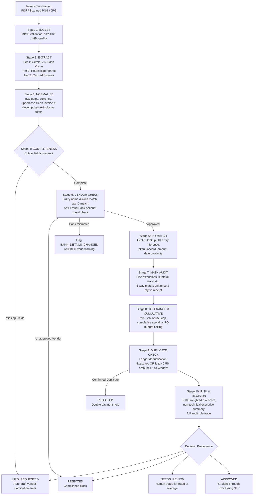

# 🛡️ INVOICE INQUEST
> **Autonomous Accounts Payable Ingestion, Audit & Decision Engine**  
> *Built as a Take-Home Case Study for the AI Solutions Analyst Role.*


---

## ⚡ Executive Overview

**INVOICE INQUEST** is a mission-control web application that ingests accounts-payable invoices (clean PDFs, multi-part instalments, or crumpled scanned phone receipts) and produces a **reasoned, fully explainable, deterministic disbursement decision**.

### The Core Architectural Tenet:
> **AI Extracts Data; Deterministic Code Decides Payment.**  
Large Language Models (LLMs) are probabilistic and prone to hallucination or stochastic drift. Financial audits and regulatory compliance require explainable, rule-by-rule execution traces where every dollar variance is provable in an audit court. In INVOICE INQUEST, multimodal AI (Google Gemini 2.5 Flash) is strictly quarantined to optical data extraction (OCR). Downstream decisioning is handled by pure, unit-tested TypeScript engines.

---

## 🏗️ Architecture & Pipeline Flow



---

## 🧪 Edge-Case Matrix & Test Scenarios

| Sample File | Scenario Category | Invoiced Facts | Expected Decision | Why It Happened & Action Taken |
| :--- | :--- | :--- | :---: | :--- |
| `01_happy_path_clean.pdf` | **Baseline Clean** | Acme Industrial, PO-2026-001, 50x Gloves @ $24.99 ($1,349.46) | `APPROVED` | All 4 critical headers present, PO exact match, zero math discrepancy, supplier approved. Instant STP clearance. |
| `02_split_po_instalment_2.pdf` | **Partial Billing** | Pinnacle Office, PO-2026-004, 10x Desks @ $899 ($9,619.30) | `APPROVED` | Cumulative billed reaches $21,199.30 of $32,740.00 PO budget ($11,540.70 remaining). Encumbrance validated. |
| `02b_split_po_instalment_3_overbill.pdf` | **Budget Breach** | Pinnacle Office, PO-2026-004, Instalment 3 ($14,445.00) | `NEEDS_REVIEW` | Cumulative spend reaches $34,070.00, exceeding authorized PO ceiling by **$1,330.00** (exceeds $50 tolerance cap). Routed to procurement manager. |
| `03_near_duplicate.pdf` | **Anti-Fraud Hold** | Acme Industrial, "INV 2041 " ($1,349.46) 3 days after cleared "INV-2041" | `REJECTED` | Near-duplicate fuzzy fingerprint matches historical cleared payment. Normalized key flags identical vendor and sum. Double-billing hold. |
| `04_missing_fields.pdf` | **Missing Headers** | EuroLogistik, logistics services, no invoice number, no total | `INFO_REQUESTED` | Fails mandatory intake completeness audit. System auto-drafts a polite, formal email to EuroLogistik requesting a revised invoice. |
| `05_scanned_implied_po.png` | **Fuzzy PO + BEC Flag** | CloudNine, scanned receipt, no explicit PO, remit bank ****9934 | `NEEDS_REVIEW` | PO inferred via token Jaccard (88% confidence) and numbers match, **BUT** remit bank ****9934 differs from registered ****2256. Dual-call callback verification required. |
| `06_unapproved_vendor.pdf` | **Vendor Governance** | QuickPrint Promotional Materials, PO-2026-007 ($2,385.00) | `REJECTED` | Supplier is marked `approved: false` in Vendor Master. Corporate policy blocks disbursements to un-vetted suppliers. |

---

## 🔍 The 10 Deterministic Pipeline Stages

1. **INGEST**: Validates MIME type (`application/pdf`, `image/png`, `image/jpeg`), ensures file size $\le$ 4MB, assesses document quality (`clean` vs `scanned`).
2. **EXTRACT**: Optical extraction pipeline featuring Google Gemini 2.5 Flash Vision, falling back to local `pdf-parse` text heuristics, and cached fixtures.
3. **NORMALISE**: Standardizes dates to ISO `YYYY-MM-DD`, normalizes currency codes, strips formatting noise from invoice codes (e.g. `INV-002041` $\to$ `INV2041`), and decomposes tax-inclusive totals.
4. **COMPLETENESS**: Enforces the 4 non-negotiable accounts-payable headers: Vendor Name, Invoice Number, Invoice Date, and Grand Total. Generates an email draft if missing.
5. **VENDOR CHECK**: Validates against the Vendor Master registry using Levenshtein edit distance, aliases, and Tax IDs. Emits `BANK_DETAILS_CHANGED` anti-fraud alert if remittance accounts diverge.
6. **PO MATCH**: Performs exact lookup or fuzzy inference across line item descriptions (token Jaccard), amount proximity, and dates. Confidence $< 60\%$ triggers manual review.
7. **MATH AUDIT**: Recomputes line item extensions ($Qty \times Price$), sums subtotal, verifies statutory sales tax, and executes 3-way match against Goods Receipt quantities.
8. **TOLERANCE & CUMULATIVE**: Applies configurable variance caps ($\min(\pm 2\%, \$50)$) and verifies multi-instalment cumulative spend against total authorized encumbrance.
9. **DUPLICATE CHECK**: Screens historical ledger for exact normalized duplicates and fuzzy submissions ($\pm 0.5\%$ amount within 14-day window).
10. **RISK & DECISION**: Synthesizes a transparent 0-100 risk score and resolves strict precedence:
$$\text{INFO\_REQUESTED} > \text{REJECTED} > \text{NEEDS\_REVIEW} > \text{APPROVED}$$

---

## 📐 Documented Assumptions

1. **AI Extraction Boundaries**: AI is used solely for optical data extraction and prose polishing of the non-technical summary. Decision logic is 100% deterministic code.
2. **Stateless Server Architecture**: The Next.js API route is stateless. The client sends the current PO ledger, vendor registry, and historical runs with each SSE request. Run history is persisted in browser `localStorage`.
3. **Tax-Inclusive Decomposition**: If an invoice marks `taxIncluded: true`, the system extracts pre-tax subtotal by dividing by $(1 + \text{taxRate})$ for equitable comparison against pre-tax PO commitments.
4. **Bank Account Fraud Prevention**: Remittance bank modifications trigger `NEEDS_REVIEW` regardless of financial precision to combat Business Email Compromise (BEC).
5. **Configurable Tolerances**: Price variance tolerances are dynamic and re-evaluated in client memory via the interactive Tolerance Lab.

---

## 🚀 Getting Started Locally

### Prerequisites
- Node.js 18+ (tested with Node 20 / 22)
- npm or pnpm

### 1. Clone & Install
```bash
git clone <repo-url>
cd "d:\ASA Invoice"
npm install
```

### 2. Configure Environment (Optional)
The application works **100% out of the box with zero API keys** using built-in heuristic and cached extraction engines. To test live multimodal Gemini extraction:
```bash
cp .env.example .env.local
```
Add your key:
```env
GEMINI_API_KEY=your_gemini_api_key_here
GEMINI_MODEL=gemini-2.5-flash
```

### 3. Generate Sample Documents
Create all 7 realistic sample invoices (text PDFs and scanned image receipt with noise/rotation):
```bash
npm run gen:samples
```

### 4. Run Unit Tests
Execute the 24 automated vitest test suites covering normalisation, tolerance, cumulative budgets, duplicate detection, PO inference, and precedence:
```bash
npm test
```

### 5. Build & Launch
```bash
npm run build
npm start
# or for development:
npm run dev
```
Open [http://localhost:3000](http://localhost:3000) in your browser.

---

## 🎬 Demo-Run Order Cheat Sheet

When presenting this take-home demonstration, follow this sequence:

1. **Hero Screen & Keyboard Shortcut**:
   - Press **`R`** or click **`▶ Run Demo Script`**.
   - Watch the animated 10-stage pipeline stepper execute all 5 core scenarios automatically with live packet glows, typewriter reasoning, and auditor personas.
2. **Scenario 1: Happy Path (`01_happy_path_clean.pdf`)**:
   - Observe the green rubber stamp `APPROVED` with confetti burst, 0 math variance, and STP clearance.
3. **Scenario 2: Cumulative Overbilling (`02b_split_po_instalment_3_overbill.pdf`)**:
   - Notice how instalment 1 and 2 passed, but instalment 3 is flagged `NEEDS_REVIEW` showing the exact $1,330 overage.
4. **Scenario 3: Anti-Fraud Near-Duplicate (`03_near_duplicate.pdf`)**:
   - Observe the red pulse `REJECTED` stamp and inspect the **Side-by-Side Comparison Drawer** showing the $1,349.46 match against historical `INV-2041`.
5. **Scenario 4: Missing Headers (`04_missing_fields.pdf`)**:
   - Inspect the blue `INFO_REQUESTED` verdict and click **`Copy Email Draft`** to review the auto-generated vendor request.
6. **Scenario 5: Scanned Implied PO with Bank Mismatch (`05_scanned_implied_po.png`)**:
   - Observe fuzzy PO matching linking the quote without explicit reference, but triggering a **Bank Details Changed** fraud hold.
7. **Tolerance Lab**:
   - Adjust the **Amount Tolerance** slider from 2% to 10% and observe the decision change client-side in ~2ms.
8. **Dashboard & Rulebook**:
   - Navigate to `/dashboard` to view financial savings telemetry, STP metrics, and export the run log to CSV.
   - Navigate to `/rules` to review the human-readable rulebook and PO ledger.

---

## ☁️ Deployment to Vercel

This repository is optimized for one-click deployment to Vercel:
1. Push your repository to GitHub or GitLab.
2. Import the project into Vercel.
3. In Project Settings $\to$ Environment Variables, optionally supply:
   - `GEMINI_API_KEY`: Your Google Gemini API key.
   - `GEMINI_MODEL`: `gemini-2.5-flash` (or defaults automatically).
4. Click **Deploy**. Vercel will automatically run `npm run build` with Turbopack and deploy the edge routes.

---

*Authored with strict TypeScript, Zero-any engine logic, and Accessible Dark Mission-Control UX.*
